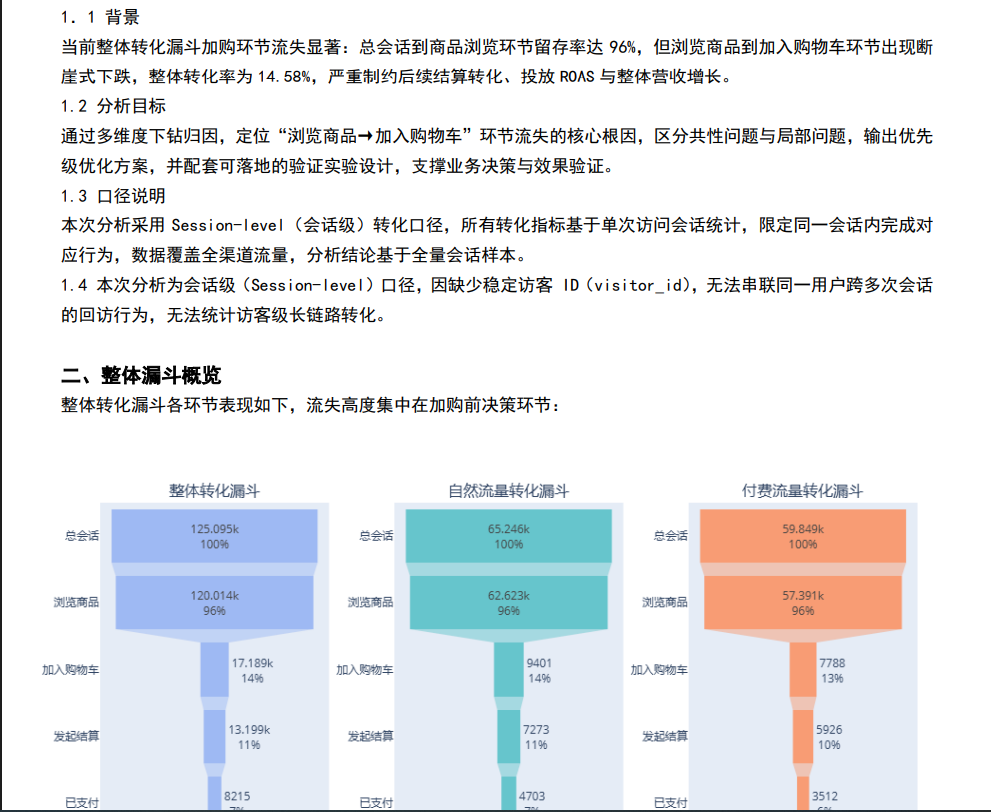
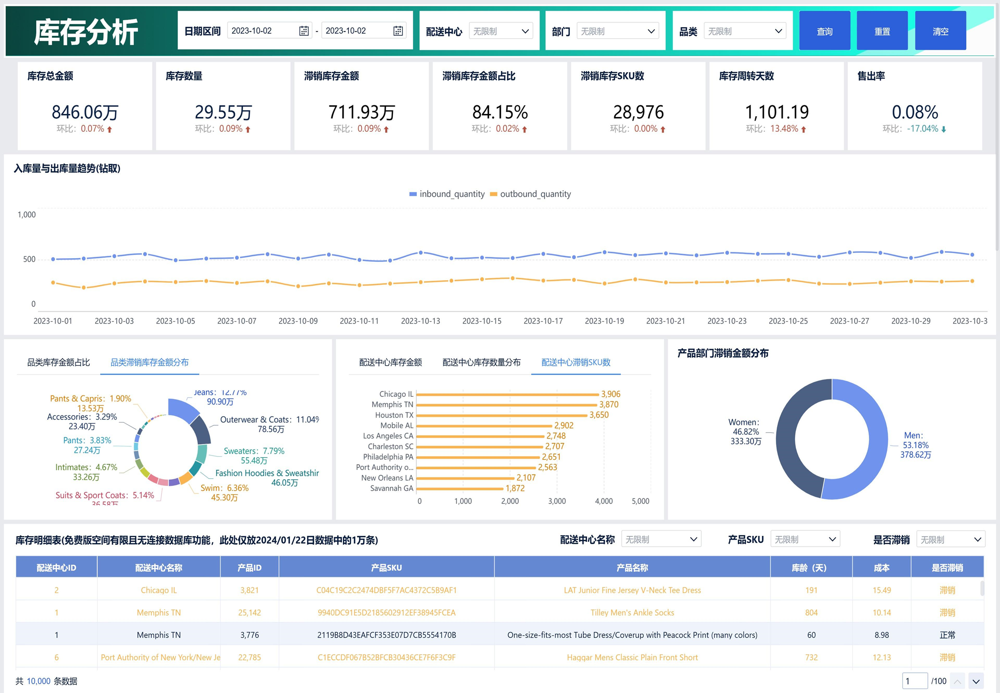
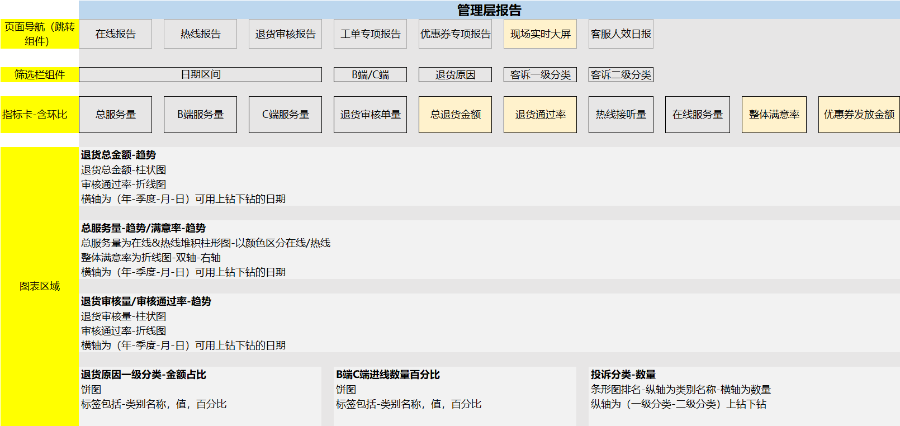
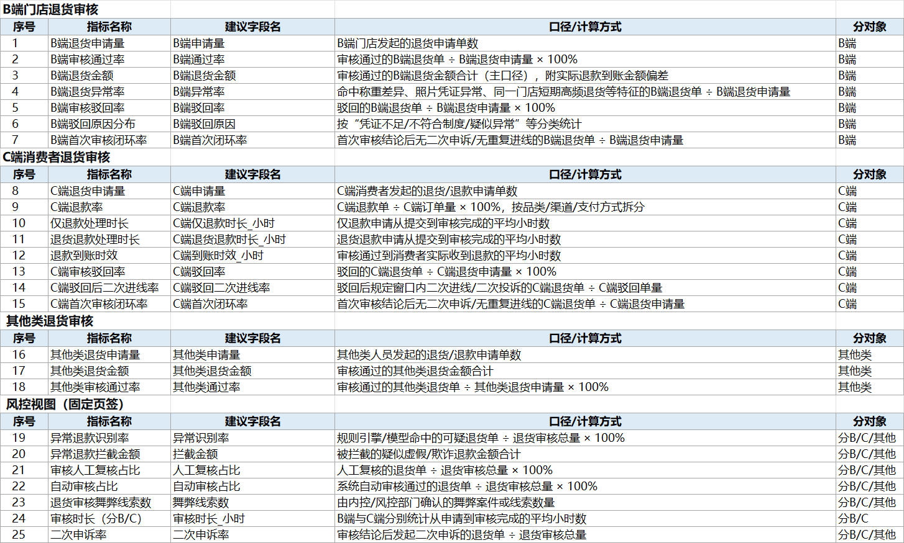

# 📊personal-portfolio 个人作品集
该账号下的personal-portfolio仓库主要用于展示作品，**所有作品均作脱敏处理，BI类作品数据集均替换为Kaggle上公开的数据集**，因此缺失数据的部分图表会作删除处理，因此对比真实业务会存在些许差距

作品主要展示三部分：BI看板、Python分析代码、专题分析报告

**转化漏斗专题**

## 📈FineBI仪表盘

线上交互看板链接：https://demo.fanruan.com/webroot/decision/link/LB06 密码：cd99

某Shopify订单销售分析看板

库存分析

## 📉客服中心脱敏作品
该部分包含以下内容，由于看板数据不便脱敏，此处不放真实报告截图

专题分析代码与结果展示

部分指标体系展示

